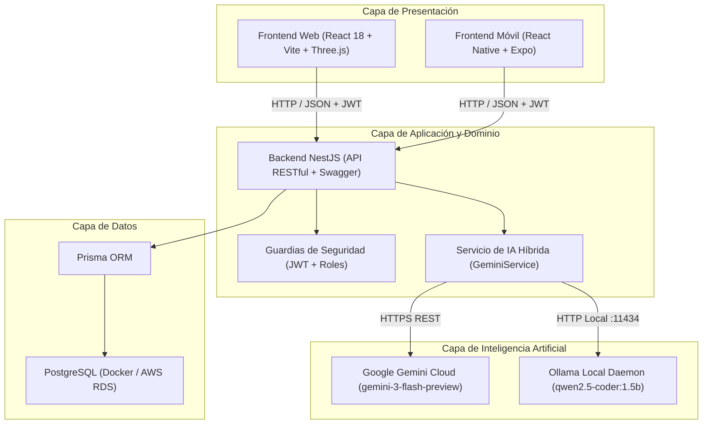
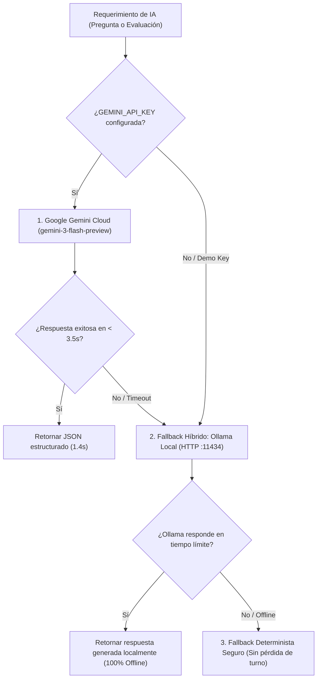
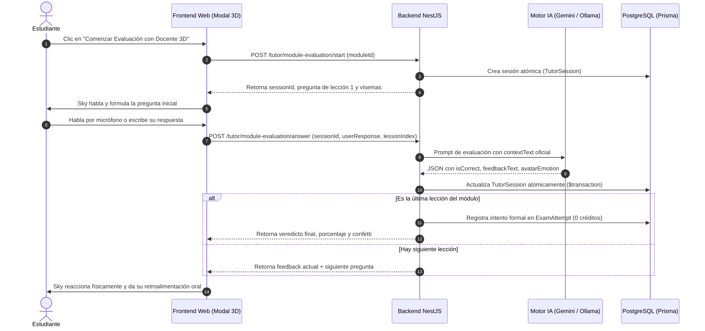

# SPEC-005 — Manual Arquitectónico Integral, Flujo de Inteligencia Artificial Híbrida y Modelo de Negocio de Skylearn

Este documento describe a detalle y punto por punto la arquitectura técnica, la comunicación entre subsistemas, el flujo y funcionamiento del motor de Inteligencia Artificial (Híbrida: Nube y Local), así como el modelo de datos y las reglas de negocio de la plataforma **Skylearn**.

---

## 1. Arquitectura y Diseño del Sistema

Skylearn está estructurado bajo una arquitectura modular desacoplada de alto rendimiento, compuesta por cuatro piezas fundamentales:



### 1.1 Comunicación Backend (NestJS) y Frontend Web (React + Three.js)
- **Protocolo de Transporte:** Comunicación asíncrona mediante peticiones HTTP RESTful formateadas en JSON estándar.
- **Cliente HTTP Centralizado:** El cliente web (`frontend-web/src/services/api.ts`) utiliza Axios con interceptores automáticos que inyectan el encabezado `Authorization: Bearer <token_jwt>` recuperado del almacenamiento local del navegador (`localStorage`).
- **Renderizado 3D Reactivo:** Para la representación del tutor virtual, React utiliza `@react-three/fiber` y `@react-three/drei` renderizando un avatar humanoide tridimensional. La boca y las posturas del avatar no dependen de modelos pesados en el cliente, sino que son controladas por una **pista de visemas temporizados** calculados por el backend en milisegundos.

### 1.2 Comunicación Backend (NestJS) y Frontend Móvil (React Native + Expo)
- **Propósito del Móvil:** Orientado a la experiencia del Docente para el seguimiento analítico en tiempo real de sus estudiantes y recepción de alertas pedagógicas.
- **Protocolo de Transporte:** Peticiones HTTP REST autenticadas por JWT usando Axios en React Native.
- **Notificaciones Push Asíncronas:** El dispositivo móvil obtiene un token único (`ExponentPushToken[...]`) mediante `expo-notifications` y lo registra en el backend (`POST /api/v1/teacher/device-token`). Cuando un estudiante reprueba dos veces una lección o se identifica un riesgo académico, el backend dispara una notificación push mediante los servidores de Expo Push API.

### 1.3 Comunicación Backend (NestJS) y Base de Datos (PostgreSQL + Prisma ORM)
- **Capa de Abstracción:** El backend interactúa con la base de datos relacional PostgreSQL exclusivamente a través de **Prisma ORM** (`backend/prisma/schema.prisma`).
- **Integridad y Transaccionalidad:** Para operaciones críticas (como registrar intentos de examen o cerrar sesiones de tutoría), el backend utiliza transacciones atómicas `prisma.$transaction(async (tx) => { ... })` que garantizan el principio ACID, evitando inconsistencias o condiciones de carrera.
- **Migraciones Controladas:** Cada cambio en el esquema se gestiona a través de Prisma Migrate (`npx prisma migrate dev`), manteniendo la consistencia de tablas, índices y llaves foráneas.

### 1.4 Seguridad, Autenticación y Autorización (JWT + RBAC)
- **Emisión de Tokens:** Al iniciar sesión (`POST /api/v1/auth/login`), el servidor valida el correo y el hash de contraseña con `bcrypt`, emitiendo un token JWT firmado con algoritmo `HS256` y una vigencia de 24 horas.
- **Guardias NestJS:**
  - `JwtAuthGuard`: Valida la existencia y firma del Bearer token.
  - `RolesGuard` + `@Roles(Role.TEACHER, Role.ADMIN)`: Comprueba que el usuario autenticado posea el rol exacto requerido para el endpoint.
  - `OptionalJwtAuthGuard`: Permite consultas públicas (ej. catálogo de cursos) pero si viene un token válido, identifica al estudiante para marcar cursos en los que ya está inscrito.

---

## 2. Flujo y Motor de Inteligencia Artificial Híbrida (Sky 3D)

### 2.1 Filosofía y Funcionamiento del Docente Virtual 3D (Sky)
Sky es un agente pedagógico conversacional diseñado para proporcionar tutoría individualizada, retroalimentación oral empática y evaluación continua. Se compone de dos modos de interacción:
1. **Consulta Didáctica Libre:** El estudiante puede hacer preguntas sobre cualquier concepto ("¿Qué es una base de datos?") y Sky responde en menos de 2 segundos, formulando analogías cotidianas y estimulando la reflexión.
2. **Evaluación Oral Modular:** Sky toma el rol de evaluador, planteando preguntas abiertas sobre cada lección del módulo, escuchando la respuesta del estudiante, evaluando su nivel de comprensión y asignando posturas corporales según el resultado.

### 2.2 Arquitectura Híbrida: Google Gemini (Nube) vs. Ollama (Local)
Para garantizar alta disponibilidad, velocidad extrema y privacidad ante contingencias de red, el sistema implementa una **estrategia de inferencia híbrida en cascada** gobernada por `GeminiService`:



1. **Nivel 1 — Google Gemini Cloud (Alta Velocidad):**
   - Utiliza el modelo oficial `gemini-3-flash-preview` configurado con `temperature: 0.2` para máxima coherencia pedagógica y salida forzada en formato JSON.
   - Tiempo de respuesta medido: **1.4 a 1.6 segundos**.
   - Si la cuota se agota o hay un problema de conectividad externa, el servicio rota automáticamente al fallback local sin interrumpir la experiencia del alumno.
2. **Nivel 2 — Ollama Local (100% Offline y Privado):**
   - Servidor local de inferencia que corre en el puerto `11434`.
   - Utiliza modelos ligeros altamente optimizados: `qwen2.5-coder:1.5b` y `llama3.2:latest`.
   - Permite que el sistema opere en redes aisladas, colegios sin internet o servidores privados.
3. **Nivel 3 — Fallback Determinista:**
   - Si ambos proveedores están temporalmente inaccesibles, el sistema activa un generador determinista seguro con mensajes pedagógicos de contingencia, impidiendo que el estudiante pierda créditos o quede bloqueado.

### 2.3 Cómo Funciona y Cómo se Conecta la IA Local (Ollama)
- **Conectividad de Red:**
  - En entorno de desarrollo (Windows/Linux local): El backend se conecta a `http://127.0.0.1:11434`.
  - En despliegue con Docker Compose (AWS/Producción): El backend se comunica con el contenedor de Ollama a través de la red interna de Docker `http://ollama:11434`.
- **Mecanismo de Autodescarga y Verificación (`ensureOllamaModel`):**
  - Al iniciar el módulo (`onModuleInit`), el backend consulta el endpoint `GET /api/tags` de Ollama.
  - Si el modelo configurado (`qwen2.5-coder:1.5b`) no existe en la máquina, el backend lanza automáticamente un `POST /api/pull` en segundo plano para descargarlo sin necesidad de intervención manual del usuario.
- **Parámetros de Inferencia Optimizados para CPU:**
  ```json
  {
    "model": "qwen2.5-coder:1.5b",
    "prompt": "...",
    "stream": false,
    "format": "json",
    "options": {
      "temperature": 0.2,
      "num_predict": 180,
      "num_thread": 4
    }
  }
  ```
  - `num_predict: 180`: Limita los tokens generados al contenido esencial, reduciendo la carga computacional en un 60%.
  - `num_thread: 4`: Aprovecha la paralelización multihilo de la CPU.
  - `format: "json"`: Obliga al modelo a emitir sintaxis JSON limpia sin bloques markdown extraños.

### 2.4 Generación y Cálculo de Visemas para Animación Labial 3D
Un **visema** es la postura visual de los labios y la boca correspondiente a un sonido fonético (fonema). Para sincronizar la boca del avatar con la voz sintética sin incurrir en latencias de red:

1. **Cálculo Determinista en el Backend (`calculateVisemes`):**
   - Se procesa el texto de respuesta analizando la secuencia de vocales y consonantes en español.
   - Cada letra o diptongo se asigna a una morfología facial reconocida por Three.js:
     - Letras **A**, **E**: forma `"aa"` / `"E"`.
     - Letras **O**, **U**: forma `"oh"` / `"ou"`.
     - Letras **I**: forma `"ih"`.
     - Silencios o pausas (espacios, comas, puntos): forma `"sil"`.
2. **Pista Temporal Monótona:**
   - Se genera un arreglo cronológico de fotogramas donde cada visema tiene un `timeMs` (incrementado a intervalos regulares de 90ms) y una intensidad `weight` (0.0 a 1.0).
3. **Reproducción en el Canvas 3D:**
   - El componente `TutorAvatar3D` interpola suavemente (*lerp*) entre los pesos de apertura de la boca según avanza la lectura de audio, logrando un efecto de sincronización labial fluido y natural.

### 2.5 Ciclo de Evaluación Pedagógica Modular Oral
El flujo completo de una evaluación con el Docente Virtual sigue 5 pasos:



- **Posturas Anatómicas del Avatar:**
  - `celebrating`: Respuesta acertada, comprensión cabal del concepto.
  - `explaining`: Respuesta orientada pero incompleta; explicación didáctica de refuerzo.
  - `encouraging`: Respuesta evasiva ("no sé") o incorrecta; postura motivacional para no desanimar al alumno.

---

## 3. Modelo de Datos, Lógica de Dominio y Reglas de Negocio

### 3.1 Jerarquía de Roles y Matriz de Control de Acceso (RBAC)

| Rol | Alcance y Capacidades Operativas |
| :--- | :--- |
| **Estudiante (`STUDENT`)** | Visualiza el catálogo general, se inscribe a cursos, consume lecciones con videos interactivos, participa en foros de comentarios, interactúa libremente con Sky en tutorías 3D, realiza evaluaciones formativas y adquiere créditos mediante Stripe. |
| **Docente (`TEACHER`)** | Gestiona **exclusivamente sus propios cursos y lecciones**, accede al gestor de contenidos docente (`#/teacher/courses`), programa reuniones virtuales en vivo por Google Meet, y supervisa el rendimiento de sus alumnos a través del dashboard analítico móvil/web con semáforos pedagógicos. |
| **Administrador (`ADMIN`)** | Monitorea la analítica global de la plataforma, audita el listado general de usuarios, ajusta saldos de créditos de forma manual y cuenta con utilitarios de mantenimiento para reiniciar la base de datos de demostración. |

### 3.2 Economía de Créditos y Pasarela de Pagos (Stripe)
- **Créditos Educativos:** Los estudiantes poseen una cuenta corriente de créditos (`CreditAccount`).
- **Desbloqueo de Lecciones:** Las lecciones avanzadas pueden requerir consumo de créditos para su desbloqueo permanente (`LessonUnlock`).
- **Garantía de Gratuidad en Evaluaciones con IA (0 Créditos):**
  - Todas las evaluaciones orales con el Docente Virtual y los exámenes de acreditación tienen un costo formal de **0 créditos**.
  - Ningún estudiante puede ser excluido de ser evaluado por Sky por falta de saldo, garantizando la equidad pedagógica.
- **Flujo de Recarga con Stripe:**
  - El estudiante solicita recargar saldo (`POST /api/v1/payments/create-checkout-session`).
  - El backend crea una sesión oficial en Stripe Checkout.
  - Tras el pago exitoso, Stripe envía un evento firmado por Webhook (`checkout.session.completed`), el cual es verificado criptográficamente en `PaymentsService` antes de acreditar los puntos al usuario.

### 3.3 Gestión de Cursos, Módulos y Lecciones
- **Integridad Relacional Descendente:**
  $$\text{Curso} \xrightarrow{\text{1 a N}} \text{Módulos} \xrightarrow{\text{1 a N}} \text{Lecciones} \xrightarrow{\text{1 a N}} \text{Exámenes / Preguntas}$$
- **Políticas Antihuérfanos:**
  - La relación `Course` $\rightarrow$ `Module` $\rightarrow$ `Lesson` tiene configurada eliminación en cascada (`onDelete: Cascade`), garantizando que al eliminar una clase o módulo no queden registros flotantes.
- **Separación de Vistas (Docente vs. Catálogo):**
  - **Catálogo General (`#/courses`):** Muestra todos los cursos con estado `PUBLISHED` de la plataforma para cualquier usuario o visitante.
  - **Gestión Docente (`#/teacher/courses`):** Filtra rigurosamente por el identificador del docente autenticado (`GET /courses?teacherId=<id>`), asegurando que ningún profesor visualice o modifique material que no sea de su autoría.

### 3.4 Evaluaciones Modulares y Prevención de Concurrencia
Para evitar trampas, pérdida de progreso o condiciones de carrera durante la evaluación con Sky:
- **Sesión Efímera Única (`TutorSession`):**
  - Al iniciar una evaluación se crea un registro de sesión vinculado al usuario, al módulo y a la lección actual.
  - Cada respuesta enviada por el estudiante debe incluir obligatoriamente el `sessionId`.
- **Bloqueo contra Respuestas Duplicadas:**
  - En la transacción de respuesta se comprueba que `nextIndex === dto.lessonIndex`. Si el usuario envía dos veces la misma respuesta o hace doble clic en el botón de enviar, el backend rechaza el segundo intento con error `409 Conflict`, impidiendo notas dobles.
- **Historial Formal de Acreditación (`ExamAttempt`):**
  - Al concluir la última lección del módulo, el sistema calcula el promedio de aciertos.
  - Si el porcentaje es mayor o igual a **70%**, se registra el intento como aprobado (`isPassed = true`) y se habilitan los siguientes módulos del plan formativo.

### 3.5 Analítica Académica y Alertas Docentes en Tiempo Real
El módulo analítico (`AnalyticsService`) procesa constantemente el rendimiento estudiantil para entregar herramientas pedagógicas al docente:
- **Los 3 KPIs Fundamentales:**
  1. Cantidad total de estudiantes aprobados.
  2. Cantidad de estudiantes reprobados o en riesgo.
  3. Promedio global de calificaciones en las evaluaciones del curso.
- **Semáforo Pedagógico:**
  - 🟢 **Verde (Bajo Riesgo):** Tasa de aprobación $\ge 80\%$.
  - 🟡 **Amarillo (Riesgo Medio):** Tasa de aprobación entre $60\%$ y $79\%$.
  - 🔴 **Rojo (Riesgo Crítico):** Tasa de aprobación $< 60\%$.
- **Detección Automática de Lecciones Críticas:** El sistema identifica automáticamente qué lección específica presenta la mayor tasa de fallas conceptuales en las evaluaciones de Sky, alertando al profesor para que organice una reunión en vivo de refuerzo.

---

## 4. Resumen de Puertos y Variables de Conexión del Ecosistema

| Componente | Puerto Local | Puerto Producción (AWS) | Protocolo / Destino |
| :--- | :--- | :--- | :--- |
| **Backend NestJS** | `3000` | `3000` (interno Docker) | API REST HTTP / JSON |
| **Frontend Web React** | `5173` | `80` / `443` (Nginx) | Interfaz web del estudiante y docente |
| **Ollama Local Daemon**| `11434` | `11434` (interno Docker) | API de inferencia de modelos IA |
| **PostgreSQL** | `5432` | `5432` (interno Docker) | Motor relacional de base de datos |
| **Google Generative AI**| Salida HTTPS | Salida HTTPS | Conexión cloud a `generativelanguage.googleapis.com` |


kpi para el panel administrativo 
reuniones programada por el docente para los alumnos 
 comentarios en cada leeccion 